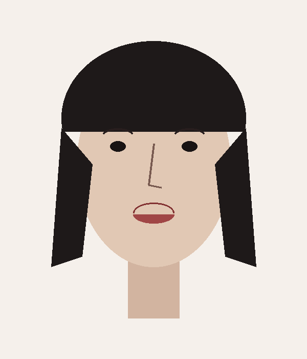
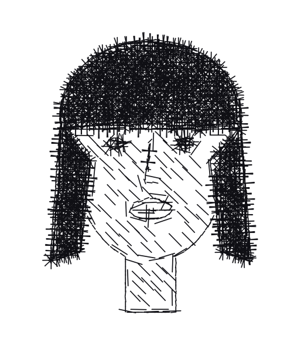
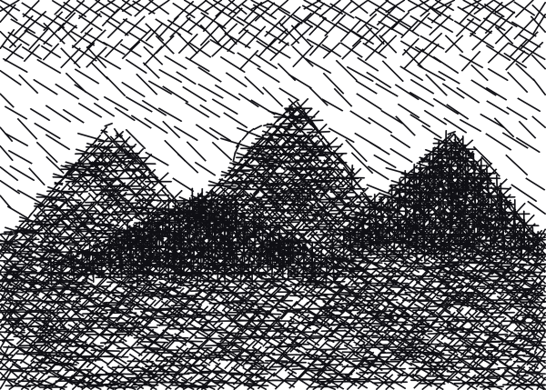
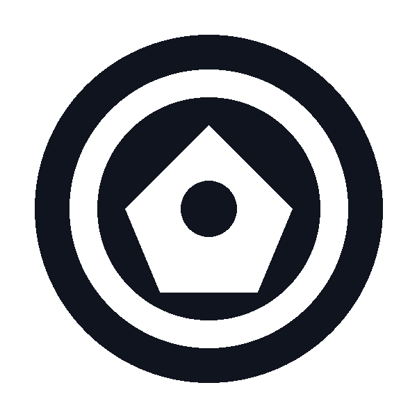
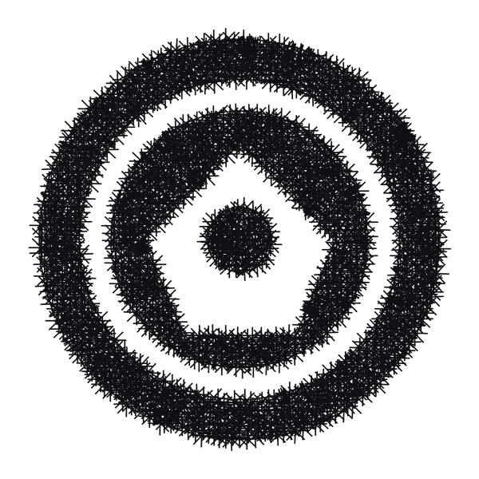

# Image Reconstruction Using Mathematical Line Art in Python

A high-performance Python application that reconstructs photographic images, portraits, landscapes, and geometric designs using **thin straight line segments**. Tonal shading, textures, silhouettes, and depth emerge naturally through spatial variations in line density, spacing, orientation fields, length, and crosshatching intersections—reminiscent of master engraving, etching, and mathematical halftoning.

---

## Visual Comparison

| Input Image | Grayscale Target $I(x, y)$ | Mathematical Line Art Reconstruction |
| :---: | :---: | :---: |
|  | Grayscale intensity map |  |
|  | Sunset gradient target |  |
|  | High-contrast emblem |  |

*(Generated comparison figures are saved directly to `samples/*_comparison_*.png`)*

---

## 1. Mathematical Architecture & Methods

The core algorithm is built entirely on continuous mathematical analysis of image fields:

### A. Grayscale Normalization and Darkness
Let $I(x, y) \in [0.0, 1.0]$ denote the normalized image intensity where $0.0$ represents pure black and $1.0$ represents pure white. The darkness field $D(x, y)$ is defined as:
$$D(x, y) = 1.0 - I(x, y)$$

Gaussian smoothing with standard deviation $\sigma$ is applied prior to differentiation:
$$I_\sigma(x, y) = I(x, y) * G_\sigma(x, y)$$

### B. Gradient Analysis and Edge Detection
Horizontal and vertical image gradients are computed using Sobel operators:
$$G_x = \frac{\partial I_\sigma}{\partial x}, \quad G_y = \frac{\partial I_\sigma}{\partial y}$$
$$G(x, y) = \sqrt{G_x(x, y)^2 + G_y(x, y)^2}$$

Structural boundaries are isolated with adaptive Canny thresholding, dynamically tuned by `edge_sensitivity`.

### C. Orientation Fields via Structure Tensor
To avoid discrete direction snapping and establish continuous, flow-aligned contour lines without $180^\circ$ ambiguity, the 2D structure tensor (second-moment matrix) is computed:
$$J = \begin{pmatrix} J_{xx} & J_{xy} \\ J_{xy} & J_{yy} \end{pmatrix} = \begin{pmatrix} G_x^2 & G_x G_y \\ G_x G_y & G_y^2 \end{pmatrix}$$

Components are spatially smoothed by Gaussian kernel $\sigma_{smooth}$:
$$\bar{J} = J * G_{\sigma_{smooth}}$$

The principal contour flow direction $\theta_{contour}(x, y)$ is tangent to image isophotes (perpendicular to gradient):
$$\theta_{contour}(x, y) = \frac{1}{2} \operatorname{atan2}(2 \bar{J}_{xy}, \bar{J}_{xx} - \bar{J}_{yy}) + \frac{\pi}{2}$$

Coherence (anisotropy) $C \in [0, 1]$ measures local edge strength versus flat isotropic tone:
$$C = \frac{\sqrt{(\bar{J}_{xx} - \bar{J}_{yy})^2 + 4 \bar{J}_{xy}^2}}{\bar{J}_{xx} + \bar{J}_{yy} + \epsilon}$$

### D. Adaptive Density and Spacing
Line density $\rho(x, y)$ scales with darkness according to power-law parameter $\gamma$:
$$\rho(x, y) = \rho_{min} + D(x, y)^\gamma \cdot (\rho_{max} - \rho_{min})$$
- $\rho_{min} = 0.0$ allows bright highlights to remain unmarred pure white paper.
- $\rho_{max}$ governs the maximum stroke density in deepest shadows.
- Target spacing:
$$\operatorname{spacing}(x, y) = \frac{1}{\rho(x, y)}$$
When $\rho(x, y) \le 10^{-5}$, spacing defaults safely to maximum canvas dimensions.

### E. Adaptive Variable-Radius Poisson-Disc Sampling
Rather than drawing complete lines at every pixel or using regular grids that cause Moire interference, seed coordinates are sampled with variable-radius Poisson disc exclusion:
$$r(x, y) \propto \operatorname{spacing}(x, y)$$
A spatial hash grid index guarantees $O(1)$ neighbor distance queries, yielding $O(N)$ overall sampling performance across large image resolutions.

### F. Multi-Family Crosshatching & Edge Preservation
At each sampled location $(x_0, y_0)$, the number of active line families $k \in \{0, 1, 2, 3, 4\}$ is determined by local darkness $D(x_0, y_0)$:
- **Highlights ($D < 0.12$):** 0 families (pure white space).
- **Quartertones ($0.12 \le D < 0.35$):** 1 family (primary contour or engraving direction).
- **Midtones ($0.35 \le D < 0.60$):** 2 families (perpendicular or complementary crosshatch).
- **Shadows ($0.60 \le D < 0.82$):** 3 families (triple hatch).
- **Deep Shadows ($D \ge 0.82$):** 4 families (dense multi-angle intersections).

Critical structural contours (facial features, sharp borders) are reinforced with straight line segments aligned along edge tangents.

### G. Supersampled Anti-Aliased Rendering
All geometry consists strictly of straight line segments $[(x_1, y_1), (x_2, y_2)]$. Lines are rendered at supersampled scale $S \ge 2$ using sub-pixel anti-aliased Bresenham rasterization (`cv2.LINE_AA`) on a pure white canvas, then downsampled via area averaging (`cv2.INTER_AREA`). Darkness is modulated purely by line spacing and intersection density, not by varying stroke thickness.

### H. Iterative Optimization Loop
Reconstruction loss $\mathcal{L}_{total}$ balances 4 terms:
$$\mathcal{L}_{total} = w_{int} \mathcal{L}_{intensity} + w_{edge} \mathcal{L}_{edge} + w_{struct} \mathcal{L}_{structural} + w_{reg} \mathcal{L}_{regularization}$$
1. **Intensity Loss $\mathcal{L}_{intensity}$:** Mean squared error between perceptually filtered rendered linework and target grayscale.
2. **Edge Loss $\mathcal{L}_{edge}$:** Edge gradient coincidence along structural boundaries.
3. **Structural Loss $\mathcal{L}_{structural}$:** $1.0 - \operatorname{SSIM}$.
4. **Regularization $\mathcal{L}_{reg}$:** Penalty for excessive line counts and stray marks in highlights.

In each refinement pass, a residual error map $R(x, y) = D_{target}(x, y) - D_{rendered}(x, y)$ guides targeted candidate line additions in under-hatched regions ($R > 0$) and stochastic line pruning in over-hatched regions ($R < 0$).

---

## 2. Project Architecture

The codebase is organized into cleanly decoupled, testable modules:

```
linesdraw/
│
├── config.py             # LineArtConfig dataclass, parameter validation, LineSegment
├── image_processing.py   # Normalization, Gaussian smoothing, Sobel gradients, structure tensor, Canny
├── line_generation.py    # Spatial hash index, variable-radius sampling, crosshatching, edge lines
├── renderer.py           # Supersampled anti-aliased canvas rendering, high-res export, Matplotlib preview
├── optimization.py       # Multi-term reconstruction loss and iterative refinement
├── main.py               # CLI interface, argument parser, desktop file picker, workflow orchestration
├── generate_samples.py   # Synthetic benchmark generator and style demonstration runner
│
├── requirements.txt      # Python dependencies
├── README.md             # Technical documentation and user guide
│
├── tests/
│   ├── test_config.py            # Parameter validation, boundary conditions, serialization
│   ├── test_image_processing.py  # Grayscale normalization, Sobel gradients, structure tensor
│   ├── test_line_generation.py   # Density formulas, safe spacing, family activation, seed reproducibility
│   ├── test_renderer.py          # Canvas dimensions, white background, mark darkness
│   ├── test_optimization.py      # Reconstruction loss terms, monotonic tracking
│   └── test_end_to_end.py        # Portraits, landscapes, logos, and large white areas
│
└── samples/                      # Generated input benchmarks, line art, and comparison previews
```

---

## 3. Installation

Ensure Python 3.11+ is installed.

```bash
# Clone or navigate to the directory
cd linesdraw

# Install dependencies
pip install -r requirements.txt
```

---

## 4. Usage & Example Commands

### A. Interactive Web Studio (Upload & Watch Lines Drawn Stroke-by-Stroke)
Launch the studio server:
```bash
python app.py
```
Open **`http://127.0.0.1:5000`** in your browser.
- **Drag & drop any image** or choose from the built-in benchmarks (Portrait, Landscape, Emblem Logo).
- **Watch the lines drawn one by one** on a virtual archival paper sheet with a glowing pen tip cursor.
- **Interactive transport dock:** Play, pause, step line-by-line, scrub the timeline slider back and forth, adjust drawing speed.
- **Toggle mechanical plotter sound effects** synthesized with Web Audio.
- **Export high-resolution PNG** with supersampling.

---

### B. Desktop Native Live Animator (OpenCV Window)
Watch the lines placed on screen directly via a native window:
```bash
python animate.py --input samples/sample_portrait.png --speed 4 --style adaptive
```
- `[SPACE]` to Pause / Play
- `[+]` / `[-]` to Speed Up / Slow Down
- `[R]` to Restart drawing
- `[S]` to Save a snapshot

---

### C. Standard CLI Execution
```bash
python main.py --input path/to/image.jpg --output result.png
```

### With Interactive Preview & Comparison Save
```bash
python main.py --input portrait.png --output portrait_art.png --save-comparison comparison.png --preview
```

### Desktop GUI File Picker
If no `--input` is provided or `--picker` is flagged, a native file dialog will open:
```bash
python main.py --picker --output drawing.png
```

---

## 5. Artistic Styles Gallery

The algorithm supports four distinct rendering modes via the `--style` argument:

### 1. Adaptive Contour Style (`--style adaptive` - Default)
Primary lines follow the natural curvature of facial contours and organic boundaries, with crosshatching dynamically branching off at shadows.
```bash
python main.py --input portrait.png --style adaptive --output portrait_adaptive.png
```

### 2. Minimalist Parsimonious Pursuit (`--style minimalist` - New)
Reconstructs the image using the **fewest possible clear lines** via Orthogonal Matching Pursuit (OMP), explicit $L_0$ line penalties, and duplicate rejection.
```bash
python main.py --input portrait.png --style minimalist --line-budget 120 --output portrait_minimalist.png
```

### 3. Classical Engraving Style (`--style engraving`)
Emulates historical banknote and copperplate engravings. Lines adhere to disciplined global diagonals (e.g. $45^\circ, 135^\circ$), with subtle organic bending along high-contrast features.
```bash
python main.py --input landscape.png --style engraving --gamma 1.3 --output landscape_engraving.png
```

### 4. Technical Crosshatching (`--style crosshatch`)
Clean, orthogonal crosshatch grids inspired by architectural sketches and technical pen drafting.
```bash
python main.py --input logo.png --style crosshatch --gamma 1.0 --output logo_crosshatch.png
```

### 5. Pure Contour Flow (`--style contour`)
Lines follow the structure tensor isophote directions across all tonal bands, ideal for sculptures, cloth drapery, and topographical surfaces.
```bash
python main.py --input statue.png --style contour --output statue_contour.png
```

---

## 6. User-Configurable Parameters

All parameters can be tuned via CLI flags or passed through a JSON configuration file (`--config-file`):

| Parameter | CLI Flag | Default | Description |
| :--- | :--- | :--- | :--- |
| **Max Working Dimension** | `--max-dimension` | `800` | Limits working resolution while preserving aspect ratio |
| **Export Scale** | `--output-scale` | `1.0` | Multiplier for high-resolution PNG export (e.g. `2.0`) |
| **Minimum Density** | `--rho-min` | `0.0` | Density in highlights (`0.0` leaves white space empty) |
| **Maximum Density** | `--rho-max` | `0.08` | Density in deep shadows (strokes per pixel) |
| **Darkness Response** | `--gamma` | `1.2` | Exponent $D^\gamma$ controlling contrast and midtone curve |
| **Base Spacing** | `--base-spacing` | `12.0` | Fundamental spacing scale between line centers (px) |
| **Line Thickness** | `--line-width` | `1.0` | Width of stroke at working resolution (px) |
| **Min Segment Length** | `--min-length` | `8.0` | Minimum line segment length (px) |
| **Max Segment Length** | `--max-length` | `28.0` | Maximum line segment length in flat fields (px) |
| **Orientation Angles** | `--orientation-angles`| `45 135 0 90`| Fixed family angles in degrees |
| **Crosshatch Families** | `--num-families` | `4` | Maximum active hatch directions in shadows |
| **Edge Sensitivity** | `--edge-sensitivity` | `0.4` | Canny edge detection sensitivity $[0.0, 1.0]$ |
| **Edge Weight** | `--edge-weight` | `0.35` | Density of contour-reinforcing edge lines |
| **Optimization Iterations**| `--iterations` | `3` | Refinement passes adjusting density & residual error |
| **Supersampling** | `--supersampling` | `2` | Anti-aliasing quality ($1\times, 2\times, 3\times, 4\times$) |
| **Random Seed** | `--random-seed` | `42` | Seed for exact deterministic reproducibility |

---

## 7. Performance Optimizations for Large Images

To maintain sub-second to few-second execution even on high-resolution images:
1. **Aspect-Ratio Preserved Working Resolution (`--max-dimension`):** The mathematical field analysis, structure tensor smoothing, and sampling occur at an optimized working resolution (default $800$px).
2. **Spatial Hash Indexing:** Poisson-disc neighborhood distance queries execute in guaranteed $O(1)$ average time, replacing expensive brute-force $O(N^2)$ distance matrices.
3. **High-Resolution Export Scaling (`--output-scale`):** Vectorized line coordinates $[(x_1, y_1), (x_2, y_2)]$ are continuous floats. High-resolution exports (e.g. $2400 \times 3200$px) are rendered cleanly by scaling coordinates onto the supersampled canvas without recomputing heavy image gradients.
4. **Vectorized OpenCV Primitives:** Convolution, Gaussian blurs, Sobel differentiation, and anti-aliased line drawing utilize SIMD-accelerated C++ routines via OpenCV.

---

## 8. Running Automated Tests

Run the full test suite with pytest:

```bash
python -m pytest -v
```

All 24 unit and integration tests validate:
- Grayscale normalization $I(x, y) \in [0, 1]$ and darkness mapping $D(x, y) \in [0, 1]$
- Correct Sobel gradient vectors and structure tensor orientation angles
- Zero-density safety and spacing calculations
- Line endpoint clipping and image boundary safety
- Deterministic reproducibility under identical random seeds
- Output canvas dimensions and white background verification
- End-to-end reconstruction on portraits, landscapes, high-contrast logos, and expansive white backgrounds.
